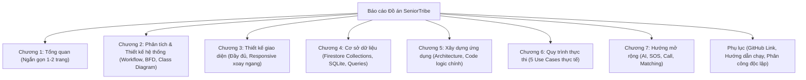
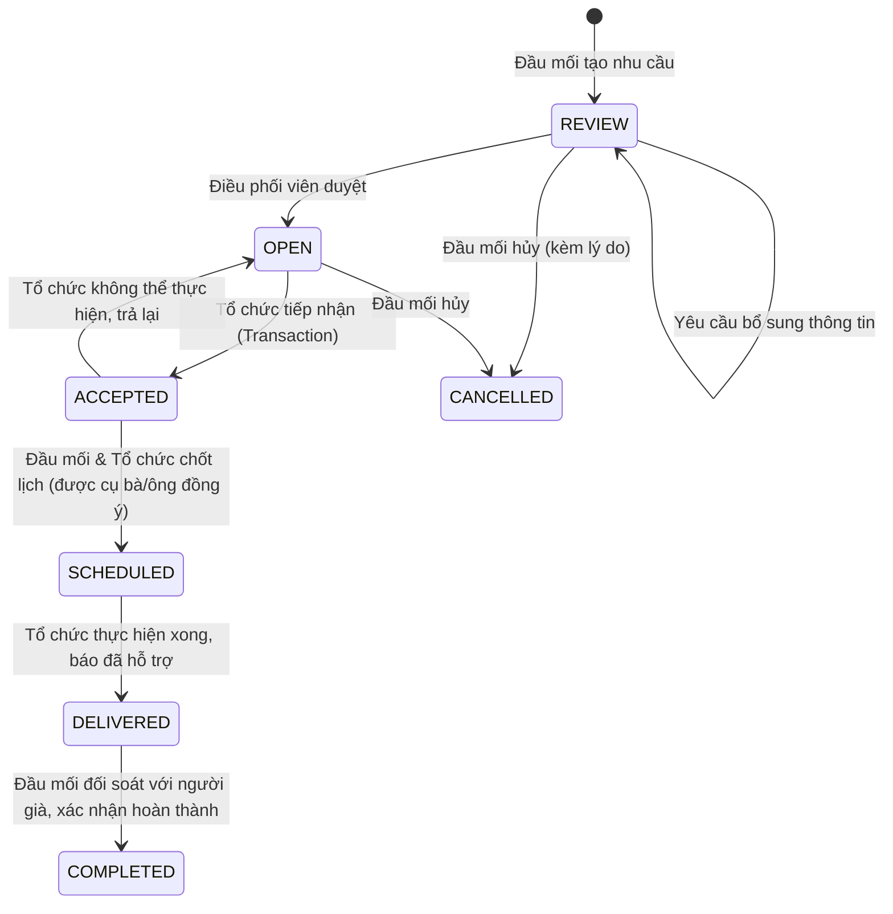

# 📋 ĐỀ CƯƠNG & KẾ HOẠCH BÁO CÁO ĐỒ ÁN SENIORTRIBE
## (Chuyển Hướng Toàn Diện Theo Mẫu "Mau Do An - Web v2.docx" & Barem Giảng Viên TS. Đặng Ngọc Hoàng Thành)

---

## 📌 THÔNG TIN ĐỒ ÁN
* **Trường:** Đại học Kinh tế TP. Hồ Chí Minh (UEH) — Trường Công nghệ và Thiết kế
* **Học phần:** Phát triển Ứng dụng Mobile
* **Giảng viên hướng dẫn:** TS. Đặng Ngọc Hoàng Thành
* **Đề tài:** **SeniorTribe — Ứng Dụng Hỗ Trợ Và Trò Chuyện Với Người Già Neo Đơn**
* **Repository GitHub:** [https://github.com/nvm4nh/MOBILE-DEV-PROJECT](https://github.com/nvm4nh/MOBILE-DEV-PROJECT)
* **Design UI/UX:** [Figma SeniorTribe](https://www.figma.com/design/joOcxsdJHhw9Dm8O4XIGUi/Untitled?node-id=0-1&t=JtOY4b3zqACJ78iL-1)
* **Danh sách nhóm:**
  1. **Nguyễn Văn Nam Anh** (Trưởng nhóm)
  2. **Trần Minh Hiếu**
  3. **Ông Tố Quyên**
  4. **Nguyễn Stefan (Trường)**

---

## 🎯 CÁC YÊU CẦU CỐT LÕI TỪ GIẢNG VIÊN (BAREM CHẤM ĐIỂM)

> [!IMPORTANT]
> 1. **Tỷ lệ điểm:** **40% Code** (phân chia kiến trúc rõ ràng) + **40% Báo cáo PDF** (đầy đủ theo mẫu, không sao chép) + **20% Demo & Vấn đáp** (5 phút).
> 2. **Kỹ thuật bắt buộc `[*]`:**
>    - **Firebase:** Authentication (Google/Email) & Cloud Firestore (Realtime).
>    - **Responsive:** Xoay màn hình không vỡ layout, không mất dữ liệu form (`onSaveInstanceState`/`ViewModel`).
>    - **SQLite Offline:** Lưu cache bài đăng để khi ngắt mạng vẫn xem lại được.
>    - **API hỗ trợ:** Google Sign-In API.
> 3. **Quy tắc phân công (Trích nguyên văn của Thầy trong Mẫu Word):**  
>    *"Nhiệm vụ cần phân công rõ ràng, không có kiểu là 'cùng nhau' làm cái này!"*  
>    Minh chứng độc lập bằng branch, commit và Pull Request trên GitHub.
> 4. **Quy tắc hình ảnh & mã nguồn:**
>    - Hình ảnh phải có chú thích và đánh số thứ tự theo chương (Ví dụ: *Hình 3.1, Hình 3.2*).
>    - Không chèn nguyên cả trang mã nguồn, chỉ đưa các hàm xử lý logic nghiệp vụ quan trọng.

---

# 📑 CHUYỂN HƯỚNG CẤU TRÚC BÁO CÁO CHI TIẾT (MỤC LỤC BÁO CÁO)



---

## CHƯƠNG 1. TỔNG QUAN *(Tối đa 1–2 trang theo đúng dặn dò của Thầy)*

*Chuyển hướng từ mục Thương mại điện tử trong mẫu Web sang Mạng xã hội hỗ trợ cộng đồng Mobile.*

### 1.1. Mạng xã hội hỗ trợ cộng đồng & Bài toán hỗ trợ người cao tuổi
* **Bối cảnh:** Già hóa dân số tại Việt Nam; người cao tuổi neo đơn thiếu giao tiếp, rào cản thao tác công nghệ.
* **Cơ sở thực tiễn:**
  * Khảo sát từ **DNXH Vầng Trăng Khuyết**: Việc tổng hợp, xác minh và giữ liên lạc với các hoàn cảnh cần giúp còn thủ công, dễ sót lọt thông tin.
  * Dự án **VIE 090 của HelpAge International tại Việt Nam**: Nhu cầu số hóa quản lý trường hợp, kết nối nguồn lực hỗ trợ có kiểm soát và muốn mở rộng quy mô (scale up).
* **Mô hình tiếp cận:** Thay vì buộc người già phải tự thao tác trên smartphone, ứng dụng tiếp cận qua **Đầu mối cộng đồng** (Cộng tác viên/Tình nguyện viên cơ sở) để ghi nhận nhu cầu, kết nối với **Tổ chức hỗ trợ**.

### 1.2. Tính cấp thiết của đề tài
* Cần một hệ thống tập trung dữ liệu nhu cầu, làm rõ trách nhiệm của đơn vị tiếp nhận, theo dõi tiến độ từng phiên hỗ trợ và **bảo vệ thông tin nhạy cảm của người cao tuổi**.

### 1.3. Các công cụ phát triển ứng dụng di động *(Thay cho HTML, CSS, JS, PHP trong mẫu Web)*
* **a) Android SDK & Java/XML:** Nền tảng phát triển ứng dụng native, kiểm soát vòng đời Activity/Fragment và bố cục màn hình tối ưu cho người già.
* **b) Firebase Authentication:** Quản lý định danh người dùng, hỗ trợ Email/Mật khẩu và Google Sign-In API.
* **c) Cloud Firestore:** Cơ sở dữ liệu đám mây NoSQL realtime, hỗ trợ offline cache, phân quyền Security Rules và cơ chế Transaction xử lý xung đột.
* **d) SQLite (Android Room/SQLiteOpenHelper):** Cơ sở dữ liệu cục bộ trên máy, lưu trữ offline các bài viết cộng đồng giúp người dùng đọc được nội dung khi mất kết nối mạng.
* **e) Figma:** Thiết kế giao diện UI/UX trực quan, xây dựng hệ thống component và màu sắc tương phản cao cho người lớn tuổi.

### 1.4. Thiết lập môi trường phát triển & Dịch vụ đám mây *(Thay cho Thiết lập máy chủ web)*
* Cấu hình Android Studio Flamingo/Giraffe, Gradle 8.x, Android SDK 34 (Android 14).
* Tạo Project Firebase, liên kết mã SHA-1, tải file cấu hình `google-services.json` vào thư mục `app/`.
* Thiết lập Firestore Indexes và Security Rules bảo vệ quyền truy cập theo đơn vị tổ chức.

---

## CHƯƠNG 2. PHÂN TÍCH VÀ THIẾT KẾ HỆ THỐNG

### 2.1. Sơ đồ công việc (Workflow Diagram)
Quy trình luân chuyển trạng thái nhu cầu hỗ trợ qua 6 bước khép kín:

* **Ma trận vai trò (Actors):**
  1. *Đầu mối cộng đồng (Reporter):* Ghi nhận trường hợp, quản lý hồ sơ riêng, đối soát kết quả.
  2. *Điều phối viên (Coordinator):* Rà soát tính hợp lệ, kiểm duyệt nội dung, chuyển trạng thái OPEN.
  3. *Đại diện tổ chức (Assignee):* Tìm kiếm, nhận ca hỗ trợ, trao đổi phương án và đề xuất lịch.
  4. *Người cao tuổi (Beneficiary):* Người được hỗ trợ, đồng ý/từ chối lịch thông qua đầu mối.

### 2.2. Sơ đồ phân rã chức năng (Business Functional Diagram - BFD)
Hệ thống được phân rã thành 5 phân hệ lớn:
1. **Phân hệ Tài khoản & Tổ chức:** Đăng ký, Đăng nhập Google/Email, Cấp quyền theo đơn vị, Hồ sơ tổ chức.
2. **Phân hệ Bảng tin Cộng đồng:** Xem danh sách bài đăng, Xem chi tiết, Đăng bài mới, Ẩn/Sửa bài viết đơn vị.
3. **Phân hệ Nhu cầu hỗ trợ:** Tạo yêu cầu hỗ trợ, Tách dữ liệu riêng tư, Rà soát duyệt nhu cầu, Tìm lọc nhu cầu OPEN, Tiếp nhận xử lý Transaction, Trả lại/Hủy.
4. **Phân hệ Phối hợp Realtime:** Chat 1-1 giữa đầu mối và người nhận, Đề xuất thời gian hẹn, Xác nhận lịch SCHEDULED, Báo hoàn thành DELIVERED, Đối soát COMPLETED.
5. **Phân hệ Khả năng sử dụng & Offline:** Xoay màn hình Responsive, Caching dữ liệu SQLite, Thông báo trạng thái mạng.

### 2.3. Sơ đồ lớp (Class Diagram)
* **Các thực thể chính:** `User`, `Organization`, `NeedSummary`, `NeedPrivateDetails`, `NeedAssignment`, `ChatMessage`, `ScheduleSession`, `PostArticle`.
* **Quan hệ cấu trúc:**
  * Mỗi `NeedSummary` (thông tin tóm tắt hiển thị mạng lưới) tham chiếu đến một `NeedPrivateDetails` (thông tin riêng tư được mã hóa quyền).
  * Mỗi `NeedAssignment` gắn liền với một phiên `ChatThread` và một `ScheduleSession`.

---

## CHƯƠNG 3. THIẾT KẾ GIAO DIỆN

> [!NOTE]
> **Quy chuẩn của Thầy:** Mỗi màn hình bắt buộc có 2 hình thức: **Hiển thị đầy đủ (Portrait)** và **Hiển thị trên Mobile khi xoay ngang (Landscape Responsive)**. Phải có phân tích UX và đánh số thứ tự ảnh: *Hình 3.1, Hình 3.2,...*

### 3.1. Giao diện Bảng tin cộng đồng (Feed)
* **a) Hiển thị dọc (Portrait):** Hình 3.1. Phân tích danh sách bài viết từ các tổ chức xã hội, nút tạo bài đăng cho đại diện.
* **b) Hiển thị xoay ngang (Landscape):** Hình 3.2. Bố cục 2 cột (hoặc lưới co giãn), thanh điều hướng chuyển sang dạng Navigation Rail để tối ưu chiều dọc.

### 3.2. Giao diện Danh sách & Chi tiết Nhu cầu hỗ trợ
* **a) Hiển thị dọc (Portrait):** Hình 3.3. Hiển thị thông tin tóm tắt (Mã ca, nhu cầu, khu vực quận/huyện, mức độ ưu tiên), che giấu địa chỉ nhà và số điện thoại.
* **b) Hiển thị xoay ngang (Landscape):** Hình 3.4. Chia màn hình: bên trái là danh sách nhu cầu, bên phải là khung xem chi tiết nhanh (Master-Detail pattern).

### 3.3. Giao diện Tìm kiếm & Lọc nhu cầu
* **a) Hiển thị dọc (Portrait):** Hình 3.5. Bộ lọc nhanh theo Khu vực địa lý, Trạng thái (OPEN) và từ khóa hỗ trợ (sinh hoạt, khám bệnh, trò chuyện).
* **b) Hiển thị xoay ngang (Landscape):** Hình 3.6. Bố cục thanh lọc nằm ngang, giữ trạng thái lọc khi đổi hướng thiết bị.

### 3.4. Giao diện Ghi nhận nhu cầu (Tạo mới trường hợp)
* **a) Hiển thị dọc (Portrait):** Hình 3.7. Form nhập liệu trực quan: tên hoàn cảnh, nhu cầu mong muốn, khu vực, bằng chứng đồng ý.
* **b) Hiển thị xoay ngang (Landscape):** Hình 3.8. Form co giãn bằng `ScrollView`, không che khuất các ô nhập liệu khi bàn phím ảo bật lên, không mất dữ liệu đang gõ dở.

### 3.5. Giao diện Chat phối hợp Realtime & Đề xuất lịch
* **a) Hiển thị dọc (Portrait):** Hình 3.9. Bong bóng tin nhắn giữa Đầu mối và Người nhận hỗ trợ, tích hợp nút "Đề xuất lịch hẹn" và thanh trạng thái phiên.
* **b) Hiển thị xoay ngang (Landscape):** Hình 3.10. Tối ưu khung nhập tin nhắn và danh sách chat ngang.

### 3.6. Giao diện Đăng nhập & Hồ sơ tài khoản
* **a) Hiển thị dọc (Portrait):** Hình 3.11. Đăng nhập Google, Email/Password, thông tin tổ chức chủ quản.
* **b) Hiển thị xoay ngang (Landscape):** Hình 3.12. Bố cục căn giữa, logo và các nút bấm co giãn hài hòa.

---

## CHƯƠNG 4. XÂY DỰNG CƠ SỞ DỮ LIỆU

### 4.1. Các bảng & Collections dữ liệu
* **Cloud Firestore (NoSQL):**
  1. Collection `users`: `uid`, `email`, `displayName`, `role` (Reporter, Coordinator, Assignee), `orgId`, `createdAt`.
  2. Collection `organizations`: `orgId`, `name`, `address`, `verified`.
  3. Collection `needs_summary` *(Public trong mạng lưới)*: `needId`, `caseCode`, `title`, `category`, `district`, `status`, `reporterUid`, `createdAt`.
  4. Collection `needs_private` *(Bảo mật cao)*: `needId`, `elderlyName`, `exactAddress`, `phoneContact`, `consentEvidenceUrl`.
  5. Collection `assignments`: `assignmentId`, `needId`, `orgId`, `assignedUserUid`, `acceptedAt`, `status`.
  6. Sub-collection `needs/{id}/messages`: `messageId`, `senderUid`, `text`, `timestamp`.
  7. Sub-collection `needs/{id}/schedules`: `scheduleId`, `proposedTime`, `agreedByElderly`, `status`.
* **SQLite (Local Database - Offline Cache):**
  1. Table `cached_articles`: `id` (INTEGER PRIMARY KEY), `server_id` (TEXT), `title` (TEXT), `content` (TEXT), `author_org` (TEXT), `updated_at` (INTEGER).

### 4.2. Sơ đồ quan hệ dữ liệu (Data Schema Diagram / ERD)
* Sơ đồ thực thể liên kết giữa Users, Organizations, Needs, Assignments và Local SQLite Cache.

### 4.3. Một số truy vấn quan trọng *(Kèm phân tích logic & mã truy vấn)*
* **a) Truy vấn danh sách nhu cầu OPEN theo khu vực (Firestore Composite Query):**
  * *Phân tích:* Lọc các nhu cầu đã được duyệt (`status == 'OPEN'`) theo địa bàn phụ trách của tổ chức, sắp xếp theo thời gian mới nhất.
  * *Mã truy vấn:*
    ```java
    db.collection("needs_summary")
      .whereEqualTo("status", "OPEN")
      .whereEqualTo("district", userDistrict)
      .orderBy("createdAt", Query.Direction.DESCENDING)
      .get();
    ```
* **b) Truy vấn Transaction tiếp nhận nhu cầu (Chống xung đột nhận trùng):**
  * *Phân tích:* Đảm bảo khi 2 tổ chức cùng bấm "Tiếp nhận" một lúc, Firestore Transaction sẽ khóa tài liệu và chỉ người đầu tiên thành công, người thứ hai nhận thông báo đã có người nhận.
  * *Mã truy vấn:*
    ```java
    db.runTransaction(transaction -> {
        DocumentSnapshot snapshot = transaction.get(needRef);
        if (!"OPEN".equals(snapshot.getString("status"))) {
            throw new FirebaseFirestoreException("Nhu cầu này đã được tiếp nhận!", ...);
        }
        transaction.update(needRef, "status", "ACCEPTED", "assigneeUid", currentUid);
        return null;
    });
    ```
* **c) Truy vấn SnapshotListener lắng nghe tin nhắn Realtime:**
  * *Phân tích:* Lắng nghe sự kiện thêm tin nhắn mới trong phiên trao đổi để cập nhật RecyclerView tức thì.
* **d) Truy vấn SQLite lưu trữ và đọc bài viết khi Offline:**
  * *Phân tích:* Câu lệnh `INSERT OR REPLACE INTO cached_articles` và `SELECT * FROM cached_articles ORDER BY updated_at DESC`.

---

## CHƯƠNG 5. XÂY DỰNG ỨNG DỤNG MOBILE

### 5.1. Cấu trúc ứng dụng (Project Architecture)
* Phân chia package theo cấu trúc Module chuẩn Android:
  * `com.seniortribe.app.models`: Định nghĩa các POJO / Data models.
  * `com.seniortribe.app.adapters`: Xử lý hiển thị danh sách RecyclerView (PostAdapter, NeedAdapter, ChatAdapter).
  * `com.seniortribe.app.activities`: Màn hình chính, Đăng nhập, Chi tiết nhu cầu, Chat.
  * `com.seniortribe.app.fragments`: Tab Bảng tin, Tab Nhu cầu, Tab Lịch hẹn, Tab Cá nhân.
  * `com.seniortribe.app.database`: `AppDatabaseHelper` quản lý SQLite cục bộ.
  * `com.seniortribe.app.utils`: Các hàm tiện ích ngày tháng, kiểm tra kết nối mạng `NetworkUtils`.

### 5.2. Kết nối và cấu hình Firebase
* Cấu hình `FirebaseFirestoreSettings.Builder().setPersistenceEnabled(true)` để kích hoạt tính năng tự động lưu cache của SDK Firebase.
* Khởi tạo `FirebaseAuth` và đăng ký lắng nghe trạng thái `AuthStateListener`.

### 5.3. Xây dựng nội dung các màn hình & Mã nguồn trọng tâm
*(Chỉ trích xuất các đoạn mã xử lý nghiệp vụ cốt lõi theo hướng dẫn của Thầy)*
* **a) Màn hình Đăng nhập & Xác thực Google Sign-In:** Code kết nối `GoogleSignInClient` và `AuthCredential`.
* **b) Màn hình Tạo nhu cầu & Tách bảo mật thông tin:** Code ghi đồng thời 2 collections `needs_summary` và `needs_private`.
* **c) Màn hình Nhận hỗ trợ & Chat realtime:** Code xử lý transaction và `addSnapshotListener`.
* **d) Màn hình Đọc bài viết Offline:** Code kiểm tra `NetworkUtils.isNetworkAvailable()`, nếu mất mạng thì load dữ liệu từ SQLite `cached_articles`.
* **e) Xử lý Responsive khi xoay màn hình:** Sử dụng `ViewModel` và `onSaveInstanceState` để lưu giữ trạng thái form, không bị reset text khi xoay máy.

---

## CHƯƠNG 6. QUY TRÌNH THỰC THI (USE CASES CHI TIẾT)

Mô tả từng bước thực thi thực tế của ứng dụng qua 5 quy trình lớn:
* **6.1. Quy trình Đăng ký, Đăng nhập & Phân quyền tổ chức:**
  Người dùng đăng nhập Google $\rightarrow$ Hệ thống kiểm tra whitelist tổ chức $\rightarrow$ Cấp quyền Đầu mối / Đại diện tổ chức.
* **6.2. Quy trình Ghi nhận và Rà soát nhu cầu:**
  Đầu mối tạo phiếu (`REVIEW`) $\rightarrow$ Điều phối viên kiểm tra tính xác thực $\rightarrow$ Duyệt mở công khai mạng lưới (`OPEN`).
* **6.3. Quy trình Tìm lọc và Tiếp nhận hỗ trợ:**
  Đại diện tổ chức lọc theo quận $\rightarrow$ Bấm tiếp nhận $\rightarrow$ Transaction khóa trạng thái $\rightarrow$ Chuyển sang `ACCEPTED`.
* **6.4. Quy trình Phối hợp qua Chat và Thống nhất lịch:**
  Hai bên mở kênh chat riêng $\rightarrow$ Đề xuất ngày giờ $\rightarrow$ Đầu mối hỏi ý kiến người cao tuổi $\rightarrow$ Chốt `SCHEDULED`.
* **6.5. Quy trình Báo hoàn thành và Đối soát kết quả:**
  Tình nguyện viên tới hỗ trợ xong $\rightarrow$ Báo `DELIVERED` $\rightarrow$ Đầu mối gặp cụ bà/ông hỏi thăm kết quả $\rightarrow$ Xác nhận `COMPLETED` $\rightarrow$ Đóng phiên chat sang chế độ chỉ đọc.

---

## CHƯƠNG 7. HƯỚNG MỞ RỘNG (EXTENSIONS)

Mô tả các module nâng cao sau khi hoàn thiện MVP (tương ứng E01–E09):
1. **E01. Nhắc lịch & Push Notification:** Tích hợp Firebase Cloud Messaging (FCM) thông báo lịch hẹn và tin nhắn mới.
2. **E02. Đổi lịch linh hoạt:** Cho phép hai bên đề xuất dời lịch có lưu vết lịch sử.
3. **E03. Đánh giá & Báo cáo phản ánh:** Chấm điểm mức độ hài lòng của phiên hỗ trợ.
4. **E04. Nhập liệu bằng giọng nói (Voice Input):** Hỗ trợ người già hoặc tình nguyện viên nói để máy tự chuyển thành văn bản.
5. **E05. Trợ lý AI (Gemini API):** Tự động tóm tắt hoàn cảnh và gợi ý nội dung tin nhắn ấm áp, ngắn gọn.
6. **E06. Gọi thoại / Video call:** Hỗ trợ kết nối trực tiếp trong trường hợp cần thiết.
7. **E07. Nhóm sinh hoạt & Sự kiện cộng đồng:** Tổ chức các buổi giao lưu tập thể cho người cao tuổi.
8. **E08. Chế độ tương phản cao & Cỡ chữ siêu lớn:** Cá nhân hóa giao diện chuyên biệt cho mắt người già.
9. **E09. Phím hỗ trợ khẩn cấp (SOS):** Định vị nhanh khi có sự cố y tế hoặc khẩn cấp.

---

## PHỤ LỤC (BẮT BUỘC THEO MẪU CỦA THẦY)

### 1. Link Mã Nguồn GitHub
* **Repository chính thức:** [https://github.com/nvm4nh/MOBILE-DEV-PROJECT](https://github.com/nvm4nh/MOBILE-DEV-PROJECT)
* Nhánh chính (`main`): Đã đồng bộ tài liệu, cấu trúc và checklist.
* Các nhánh chức năng độc lập: `feat/requests`, `feat/chat-schedule`, `feat/auth-profile`, `feat/community-offline`.

### 2. Hướng Dẫn Cài Đặt & Chạy Ứng Dụng
1. Clone mã nguồn: `git clone https://github.com/nvm4nh/MOBILE-DEV-PROJECT.git`
2. Mở project trong Android Studio (khuyến nghị phiên bản Hedgehog trở lên).
3. Đặt file `google-services.json` vào thư mục `SeniorTribeApp/app/`.
4. Cấu hình SDK Android 34 trong `local.properties`.
5. Đồng bộ Gradle (`Sync Project with Gradle Files`).
6. Chạy trên máy ảo (Emulator API 30+) hoặc thiết bị thật đã bật USB Debugging.

### 3. BẢNG PHÂN CÔNG NHIỆM VỤ CHI TIẾT (ĐỘC LẬP TỪNG THÀNH VIÊN)

> [!CAUTION]
> Tuân thủ tuyệt đối quy định của Giảng viên: Phân chia trách nhiệm rõ ràng đến từng cá nhân, không ghi chung chung, có minh chứng Git commit/PR tương ứng!

| STT | Thành viên | Vai trò & Nhánh Git | Nhiệm vụ Code thực tế | Nhiệm vụ Viết Báo cáo | Minh chứng GitHub |
|:---:|:---|:---|:---|:---|:---:|
| 1 | **Nguyễn Văn Nam Anh** *(Leader)* | **Trưởng nhóm**<br>Nhánh: `feat/requests`, `main` | • Khởi tạo kiến trúc project Android chung.<br>• Viết chức năng Tiếp nhận bằng Firestore Transaction (F10).<br>• Viết chức năng Hủy/Trả lại nhu cầu (F14).<br>• Xử lý chống trùng tiếp nhận. | • Vẽ Sơ đồ công việc (Workflow Diagram - Mục 2.1).<br>• Viết Chương 6: Quy trình thực thi.<br>• Phụ trách mục Lịch và Chat (Mục 5.3).<br>• Chuẩn bị slide thuyết trình & điều phối demo. | Commit: `78cfc18`, `90f8d1a`<br>PR #3, PR #4 |
| 2 | **Trần Minh Hiếu** | **Thành viên**<br>Nhánh: `feat/requests` | • Xây dựng chức năng Ghi nhận nhu cầu (F06).<br>• Viết chức năng Rà soát, duyệt nhu cầu (F07).<br>• Viết chức năng Xem và Lọc nhu cầu (F08, F09).<br>• Cấu hình Firestore Security Rules. | • Viết Chương 2: Sơ đồ phân rã chức năng (BFD - Mục 2.2).<br>• Viết Chương 4: Cơ sở dữ liệu & Truy vấn Firestore.<br>• Soạn Phụ lục hướng dẫn cài đặt và tổng hợp PDF. | Nhánh `feat/requests`<br>Issue #1, PR tuần 1 |
| 3 | **Ông Tố Quyên** | **Thành viên**<br>Nhánh: `feat/chat-schedule` | • Xây dựng module Chat realtime 1-1 bằng Firestore (F11).<br>• Xây dựng module Thống nhất lịch hẹn (F12).<br>• Xây dựng chức năng Đối soát và Hoàn thành ca hỗ trợ (F13, F15).<br>• Kiểm tra và merge PR tuần 1, tuần 2. | • Viết Chương 2: Sơ đồ lớp (Class Diagram - Mục 2.3).<br>• Viết Chương 5: Mục 5.1 Cấu trúc app & Mục 5.3 Chat/Lịch.<br>• Kiểm tra lỗi xoay màn hình mục chat.<br>• Chạy thử nghiệm các luồng tích hợp chung. | Commit: `4455569`, `23183e1`<br>PR #2 |
| 4 | **Nguyễn Stefan (Trường)** | **Thành viên**<br>Nhánh: `feat/auth-profile`, `feat/community-offline` | • Xây dựng Đăng nhập Email/Google & Phân quyền tổ chức (F01–F03).<br>• Xây dựng Bảng tin và Đăng bài viết cộng đồng (F04, F05).<br>• Xây dựng bộ nhớ đệm Offline lưu bài đăng bằng SQLite (F16, T05).<br>• Xử lý Responsive khi xoay ngang màn hình (T04). | • Viết Chương 1: Tổng quan đề tài & công cụ (Mục 1.1–1.4).<br>• Viết Chương 3: Thiết kế giao diện (chụp ảnh dọc/ngang).<br>• Viết Chương 5: Mục 5.2 Kết nối DB & Mục 5.3 Offline SQLite.<br>• Kiểm tra đạo văn Turnitin (< 20%). | Nhánh `feat/community-offline`<br>PR #1 |

---

## TÀI LIỆU THAM KHẢO

1. **Google Developers.** *Android Documentation: Build an Android App with Architecture Components & Material Design.* [https://developer.android.com](https://developer.android.com).
2. **Google Firebase.** *Cloud Firestore & Firebase Authentication for Android.* [https://firebase.google.com/docs/android/setup](https://firebase.google.com/docs/android/setup).
3. **Doanh nghiệp Xã hội Vầng Trăng Khuyết.** *Báo cáo thực tiễn về công tác hỗ trợ người già neo đơn và điều phối cứu trợ cộng đồng.* TP. Hồ Chí Minh, 2024.
4. **HelpAge International in Vietnam.** *Dự án VIE 090: Nhân rộng mô hình quản lý trường hợp và chăm sóc người cao tuổi có hoàn cảnh khó khăn.* Hà Nội, 2023.
5. **TS. Đặng Ngọc Hoàng Thành.** *Bài giảng và Hướng dẫn Đồ án môn học Phát triển Ứng dụng Mobile.* Trường Công nghệ và Thiết kế, Đại học Kinh tế TP. Hồ Chí Minh (UEH), 2026.
