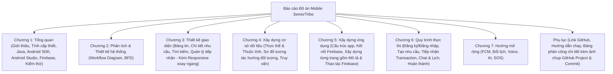
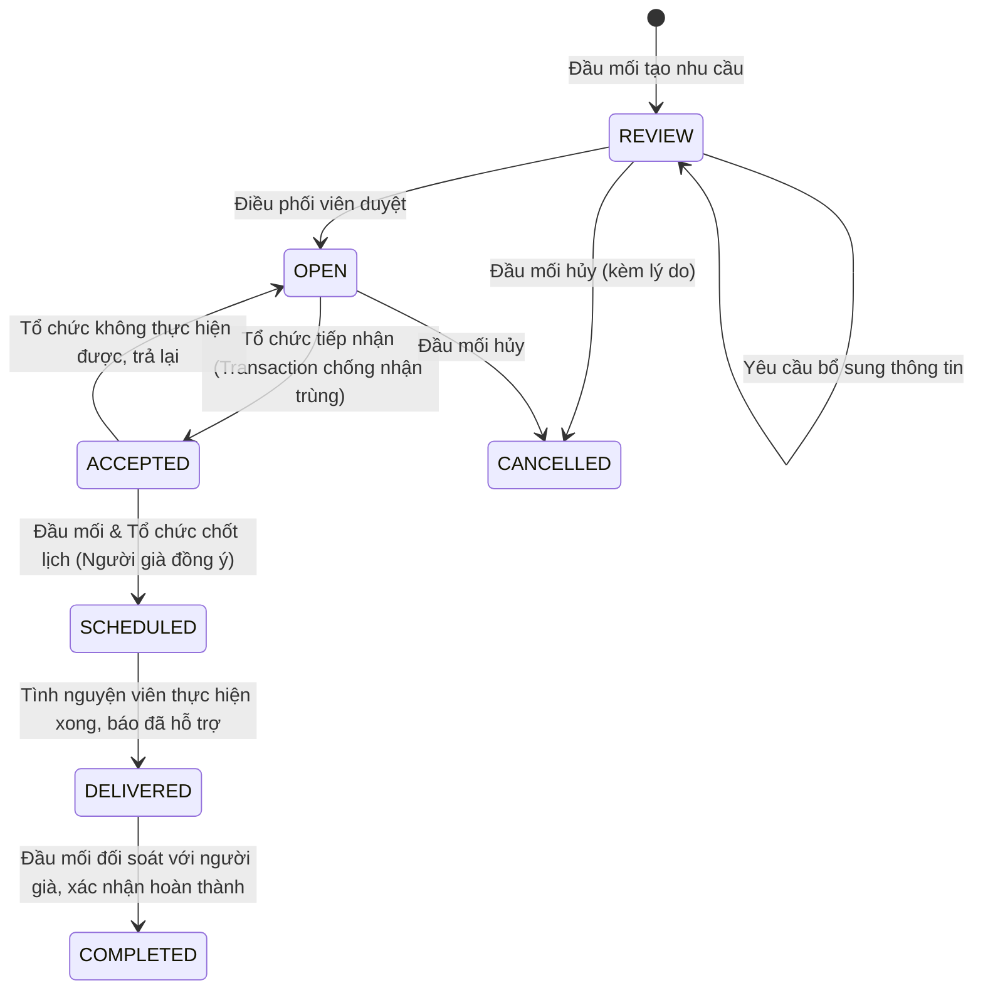

# 📋 ĐỀ CƯƠNG & KẾ HOẠCH BÁO CÁO ĐỒ ÁN SENIORTRIBE
## (Chuẩn Hóa 100% Theo Mẫu Chính Thức "Mau Do An - Mobile v2.docx" & Barem Giảng Viên TS. Đặng Ngọc Hoàng Thành)

---

## 📌 THÔNG TIN ĐỒ ÁN
* **Cơ sở đào tạo:** Trường Công nghệ và Thiết kế — Đại học Kinh tế TP. Hồ Chí Minh (UEH)
* **Học phần:** Phát Triển Ứng Dụng Mobile
* **Chuyên ngành:** Công Nghệ Phần Mềm — Khóa: K50
* **Giảng viên hướng dẫn:** TS. Đặng Ngọc Hoàng Thành
* **Tên đề tài:** **SENIORTRIBE — ỨNG DỤNG HỖ TRỢ VÀ TRÒ CHUYỆN VỚI NGƯỜI GIÀ NEO ĐƠN**
* **Repository GitHub:** [https://github.com/nvm4nh/MOBILE-DEV-PROJECT](https://github.com/nvm4nh/MOBILE-DEV-PROJECT)
* **Design UI/UX:** [Figma SeniorTribe](https://www.figma.com/design/joOcxsdJHhw9Dm8O4XIGUi/Untitled?node-id=0-1&t=JtOY4b3zqACJ78iL-1)
* **Danh sách thành viên:**
  1. **Nguyễn Văn Nam Anh** (Trưởng nhóm)
  2. **Trần Minh Hiếu**
  3. **Ông Tố Quyên**
  4. **Nguyễn Stefan (Trường)**

---

## 🎯 CÁC YÊU CẦU CỐT LÕI TỪ BAREM CHẤM ĐIỂM CỦA GIẢNG VIÊN

> [!IMPORTANT]
> 1. **Tỷ lệ điểm:** **40% Code** (phân chia khoa học, kiến trúc rõ ràng) + **40% Báo cáo PDF** (theo đúng mẫu, không copy/paste, ảnh có chú thích) + **20% Vấn đáp & Demo** (ngắn gọn 5 phút).
> 2. **Kỹ thuật bắt buộc `[*]`:***
>    - **Firebase:** Authentication (Google/Email) & Cloud Firestore (Realtime).
>    - **Responsive:** Xoay màn hình (Landscape / Portrait) không vỡ layout, không mất dữ liệu form (`ViewModel`, `onSaveInstanceState`).
>    - **SQLite Local/Offline:** Caching dữ liệu bài đăng về máy để ngắt mạng vẫn xem lại được những trang đã xem.
>    - **Khai thác API hỗ trợ:** Google Sign-In API.
> 3. **Quy tắc phân công của Thầy (Trích nguyên văn từ Mẫu Mobile v2):**  
>    *"Nhiệm vụ cần phân công rõ ràng, không có kiểu là 'cùng nhau' làm cái này!"*  
>    *"Cũng chụp màn hình các kết quả phân công trên GitHub project cũng như lịch sử commit làm minh chứng."*
> 4. **Quy tắc hình ảnh & mã nguồn:**
>    - Các ảnh chèn vào phải có ghi chú và số thứ tự ảnh đánh số theo chương (Ví dụ: *Hình 3.1, Hình 3.2, v.v.*).
>    - Không chèn nguyên cả trang mã nguồn, chỉ trích dẫn các đoạn mã quan trọng.

---

# 📑 CẤU TRÚC BÁO CÁO CHUẨN XÁC THEO "MAU DO AN - MOBILE V2.DOCX"



---

## CHƯƠNG 1. TỔNG QUAN *(Tối đa 1–2 trang theo đúng dặn dò của Thầy)*

### 1.1. Giới thiệu
* **Mô tả bài toán nghiên cứu:** Bài toán kết nối nhu cầu trợ giúp của người cao tuổi neo đơn với các tổ chức xã hội, đoàn thể và tình nguyện viên có năng lực hỗ trợ.
* **Cơ sở thực tiễn:**
  * Khảo sát từ **Doanh nghiệp Xã hội Vầng Trăng Khuyết**: Việc tổng hợp hoàn cảnh cần giúp, xác minh và điều phối tình nguyện viên thăm hỏi còn thủ công, dễ sót lọt.
  * Dự án **VIE 090 của HelpAge International tại Việt Nam**: Nhu cầu số hóa quản lý trường hợp, theo dõi hỗ trợ người cao tuổi có hoàn cảnh khó khăn và nhân rộng mô hình (scale up).
* **Mô hình giải pháp:** Tiếp cận thông qua **Đầu mối cộng đồng** (nhân viên/cộng tác viên cơ sở) ghi nhận nhu cầu, kết nối với **Tổ chức hỗ trợ**, người cao tuổi không bắt buộc phải có smartphone.

### 1.2. Tính cấp thiết của đề tài
* Xã hội già hóa nhanh, nhiều người già neo đơn thiếu người trò chuyện, bầu bạn và hỗ trợ việc nhà/đi khám.
* Cần một giải pháp di động tập trung thông tin nhu cầu, làm rõ trách nhiệm đơn vị nhận, cập nhật tiến độ thực thi và bảo mật thông tin nhân thân của người cao tuổi.

### 1.3. Công cụ phát triển ứng dụng di động *(Chuẩn 4 mục theo mẫu Mobile v2)*
* **a) Giới thiệu sơ lược về Java:** Ngôn ngữ lập trình hướng đối tượng chủ đạo trong phát triển Android native, kiểm soát chặt chẽ luồng xử lý và mô hình đối tượng.
* **b) Android SDK:** Bộ công cụ phát triển phần mềm cung cấp hệ thống thư viện API, trình biên dịch và nền tảng runtime trên Android (Target SDK 34 - Android 14).
* **c) Android Studio:** Môi trường phát triển tích hợp (IDE) chính thức của Google, hỗ trợ Layout Editor, quản lý build Gradle, Logcat và Profiler.
* **d) Firebase:** Nền tảng Backend-as-a-Service (BaaS) của Google, cung cấp Firebase Authentication và Cloud Firestore cơ sở dữ liệu NoSQL realtime.

### 1.4. Kiểm thử ứng dụng trên Android emulator và trên thiết bị *(Mục 1.4 chuẩn theo mẫu Mobile v2)*
* **Kiểm thử trên Android Emulator:** Chạy trên máy ảo Android Studio (Pixel 6 Pro, API Level 34), kiểm thử tính năng xoay màn hình ngang/dọc (`Landscape`/`Portrait`) và kiểm tra rò rỉ bộ nhớ.
* **Kiểm thử trên thiết bị vật lý:** Kết nối điện thoại thật qua USB Debugging, kiểm thử chức năng định vị, camera/ảnh, kết nối mạng 4G/WiFi và kịch bản ngắt mạng đột ngột (`Offline Mode`).

---

## CHƯƠNG 2. PHÂN TÍCH VÀ THIẾT KẾ HỆ THỐNG *(Chuẩn 2 mục theo mẫu Mobile v2)*

### 2.1. Sơ đồ luồng công việc (Workflow Diagram)
Quy trình luân chuyển trạng thái nhu cầu hỗ trợ qua 6 bước nghiệp vụ khép kín:

* **Ma trận các tác nhân (Actors):**
  1. *Đầu mối cộng đồng:* Ghi nhận trường hợp, tạo phiếu, bảo mật hồ sơ riêng, đối soát kết quả với người cao tuổi.
  2. *Điều phối viên:* Kiểm tra tính hợp lệ và nguồn xác minh, duyệt chuyển trạng thái `OPEN`.
  3. *Đại diện tổ chức hỗ trợ:* Tìm lọc ca phù hợp, nhận phụ trách, trao đổi phương án và đề xuất lịch.
  4. *Người cao tuổi:* Người thụ hưởng, đồng ý/từ chối lịch hẹn qua trao đổi trực tiếp với đầu mối.

### 2.2. Sơ đồ phân rã chức năng (Business Functional Diagram - BFD)
Hệ thống được phân rã thành 5 phân hệ lớn:
1. **Phân hệ Tài khoản & Phân quyền:** Đăng ký, Đăng nhập Email/Google, Phân quyền theo tổ chức (F01–F03).
2. **Phân hệ Bảng tin Cộng đồng:** Xem tin tức tổ chức, Xem chi tiết, Đăng bài viết mới, Quản lý bài đăng (F04–F05).
3. **Phân hệ Quản lý Nhu cầu:** Tạo nhu cầu (tách private/summary), Rà soát duyệt, Tìm kiếm & lọc, Tiếp nhận xử lý Transaction, Hủy/trả lại (F06–F10, F14).
4. **Phân hệ Phối hợp & Lịch hẹn:** Chat văn bản realtime 1-1, Thống nhất lịch hẹn, Ghi nhận kết quả, Xem lịch sử phiên (F11–F13, F15).
5. **Phân hệ Khả năng sử dụng & Offline:** Xoay màn hình Responsive, Caching bài viết bằng SQLite, Báo trạng thái mạng (F16, T04, T05).

---

## CHƯƠNG 3. THIẾT KẾ GIAO DIỆN
*(Áp dụng đúng lưu ý của Thầy: Hình ảnh có chú thích, đánh số theo chương Hình 3.1, 3.2... có hiển thị dọc và xoay ngang Responsive)*

### 3.1. Giao diện trang chủ *(Tương ứng: Bảng tin cộng đồng & Đăng bài)*
* **Hình 3.1:** Giao diện Bảng tin hiển thị dọc (Portrait) — Danh sách bài viết hoạt động xã hội, nút tạo bài cho đại diện.
* **Hình 3.2:** Giao diện Bảng tin xoay ngang (Landscape) — Tối ưu layout 2 cột, thanh Navigation Rail bên cạnh.

### 3.2. Giao diện trang chi tiết sản phẩm *(Tương ứng: Chi tiết nhu cầu & Hồ sơ ca hỗ trợ)*
* **Hình 3.3:** Chi tiết nhu cầu hiển thị dọc — Hiển thị bản tóm tắt công khai (Khu vực quận/huyện, loại hỗ trợ, mức độ cần kíp), che giấu thông tin nhạy cảm.
* **Hình 3.4:** Chi tiết nhu cầu xoay ngang — Phân chia bố cục Master-Detail trực quan.

### 3.3. Giao diện trang tìm kiếm *(Tương ứng: Tìm kiếm & Lọc nhu cầu OPEN)*
* **Hình 3.5:** Giao diện tìm kiếm dọc — Bộ lọc theo Quận/Huyện, chủ đề hỗ trợ (sinh hoạt, tâm sự, khám bệnh).
* **Hình 3.6:** Giao diện tìm kiếm xoay ngang — Bố cục thanh lọc ngang linh hoạt.

### 3.4. Giao diện trang giỏ hàng *(Tương ứng: Quản lý nhu cầu đã tiếp nhận & Lịch hẹn / Chat)*
* **Hình 3.7:** Giao diện Quản lý ca đã nhận dọc — Danh sách ca đang phụ trách, nút mở chat và trạng thái lịch hẹn.
* **Hình 3.8:** Giao diện Khung chat & Đề xuất lịch xoay ngang — Tối ưu màn hình ngang cho việc gõ tin nhắn.

---

## CHƯƠNG 4. XÂY ZỰNG CƠ SỞ DỮ LIỆU *(Chuẩn 3 mục theo mẫu Mobile v2)*

### 4.1. Các thực thể (Entity) và các thuộc tính
* **1. Thực thể `User`:** `uid` (String), `email` (String), `displayName` (String), `role` (String: Reporter/Coordinator/Assignee), `orgId` (String), `createdAt` (Timestamp).
* **2. Thực thể `Organization`:** `orgId` (String), `name` (String), `address` (String), `verified` (Boolean).
* **3. Thực thể `NeedSummary` (Public trong mạng lưới):** `needId` (String), `caseCode` (String), `title` (String), `category` (String), `district` (String), `status` (String: REVIEW, OPEN, ACCEPTED, SCHEDULED, DELIVERED, COMPLETED, CANCELLED), `reporterUid` (String), `createdAt` (Timestamp).
* **4. Thực thể `NeedPrivateDetails` (Bảo mật cao):** `needId` (String), `elderlyName` (String), `exactAddress` (String), `phoneContact` (String), `consentEvidenceUrl` (String).
* **5. Thực thể `NeedAssignment`:** `assignmentId` (String), `needId` (String), `orgId` (String), `assigneeUid` (String), `acceptedAt` (Timestamp), `status` (String).
* **6. Thực thể `ChatMessage`:** `messageId` (String), `senderUid` (String), `text` (String), `timestamp` (Timestamp).
* **7. Thực thể `ScheduleSession`:** `scheduleId` (String), `proposedTime` (Timestamp), `agreedByElderly` (Boolean), `status` (String).
* **8. Thực thể `CachedArticle` (SQLite Local):** `id` (Integer PK), `serverId` (Text), `title` (Text), `content` (Text), `authorOrg` (Text), `updatedAt` (Integer).

### 4.2. Sơ đồ tương tác hướng đối tượng *(Mục 4.2 chuẩn theo mẫu Mobile v2)*
* Sơ đồ tương tác thể hiện mối quan hệ liên kết và luân chuyển thông điệp giữa các đối tượng: `User` $\leftrightarrow$ `Organization` $\leftrightarrow$ `NeedSummary` $\leftrightarrow$ `NeedAssignment` $\leftrightarrow$ `ChatMessage` $\leftrightarrow$ `ScheduleSession`.

### 4.3. Một số truy vấn *(Kèm phân tích & Mã Java/Firestore/SQLite theo mẫu)*
* **a) Truy vấn liệt kê danh sách nhu cầu OPEN theo khu vực:**
  * *Phân tích:* Lấy danh sách các ca đã duyệt đang chờ tiếp nhận thuộc địa bàn của tổ chức, sắp xếp theo thời gian mới nhất.
  * *Truy vấn Java (Firestore Query):*
    ```java
    db.collection("needs_summary")
      .whereEqualTo("status", "OPEN")
      .whereEqualTo("district", userDistrict)
      .orderBy("createdAt", Query.Direction.DESCENDING)
      .get();
    ```
* **b) Truy vấn Transaction tiếp nhận nhu cầu (Chống xung đột nhận trùng):**
  * *Phân tích:* Khóa tài liệu nhu cầu trong Firestore Transaction; nếu trạng thái vẫn là `OPEN` thì mới gán người nhận và chuyển sang `ACCEPTED`, tránh trường hợp 2 tổ chức cùng nhận một ca.
  * *Truy vấn Java (Firestore Transaction):*
    ```java
    db.runTransaction(transaction -> {
        DocumentSnapshot snapshot = transaction.get(needRef);
        if (!"OPEN".equals(snapshot.getString("status"))) {
            throw new FirebaseFirestoreException("Nhu cầu này đã có người tiếp nhận!", 
                FirebaseFirestoreException.Code.ABORTED);
        }
        transaction.update(needRef, "status", "ACCEPTED", "assigneeUid", currentUid);
        return null;
    });
    ```
* **c) Truy vấn SnapshotListener lắng nghe tin nhắn Realtime:**
  * *Phân tích:* Lắng nghe sự kiện thêm mới tin nhắn theo thời gian thực trong phòng chat giữa đầu mối và đại diện.
* **d) Truy vấn SQLite lưu trữ và đọc bài viết khi Offline:**
  * *Phân tích:* Câu lệnh SQL `INSERT OR REPLACE INTO cached_articles` và `SELECT * FROM cached_articles ORDER BY updated_at DESC`.

---

## CHƯƠNG 5. XÂY DỰNG ỨNG DỤNG *(Chuẩn theo mẫu Mobile v2)*

### 5.1. Cấu trúc của ứng dụng
* Cấu trúc phân lớp module chuẩn Android Native:
  * `com.seniortribe.app.models`: Chứa các POJO Data Model (`User.java`, `NeedSummary.java`, `Message.java`).
  * `com.seniortribe.app.adapters`: Xử lý binding dữ liệu vào RecyclerView (`PostAdapter`, `NeedAdapter`, `ChatAdapter`).
  * `com.seniortribe.app.activities`: Quản lý vòng đời Activity (`MainActivity`, `LoginActivity`, `NeedDetailActivity`, `ChatActivity`).
  * `com.seniortribe.app.fragments`: Các màn hình phân hệ (`FeedFragment`, `NeedListFragment`, `ProfileFragment`).
  * `com.seniortribe.app.database`: Lớp `AppDatabaseHelper` kế thừa `SQLiteOpenHelper`.
  * `com.seniortribe.app.utils`: Các tiện ích xử lý định dạng, mạng `NetworkUtils`.

### 5.2. Kết nối với Firebase
* Đặt cấu hình `google-services.json`, khởi tạo `FirebaseApp.initializeApp(context)`.
* Cấu hình bật Local Persistence:
  ```java
  FirebaseFirestoreSettings settings = new FirebaseFirestoreSettings.Builder()
      .setPersistenceEnabled(true)
      .build();
  db.setFirestoreSettings(settings);
  ```

### 5.3. Xây dựng nội dung các trang *(Mỗi trang gồm: 1. Mô tả chức năng & 2. Thao tác dữ liệu Firebase)*
* **a) Trang Bảng tin cộng đồng (Home Feed):**
  * *Mô tả chức năng:* Hiển thị bài viết của các tổ chức xã hội, hỗ trợ xem offline khi mất mạng.
  * *Trình bày thao tác dữ liệu với Firebase & SQLite:* Tải danh sách bài viết từ collection `posts`; đồng thời lưu cache vào bảng SQLite `cached_articles`.
* **b) Trang Chi tiết nhu cầu hỗ trợ:**
  * *Mô tả chức năng:* Hiển thị tóm tắt thông tin ca cần giúp; chỉ mở thông tin riêng khi là đầu mối hoặc người nhận ca.
  * *Trình bày thao tác dữ liệu với Firebase:* Đọc dữ liệu từ `needs_summary/{id}` và truy vấn có điều kiện tới `needs_private/{id}`.
* **c) Trang Tìm kiếm & Lọc nhu cầu:**
  * *Mô tả chức năng:* Lọc nhanh theo Quận/Huyện, từ khóa, sắp xếp theo độ ưu tiên.
  * *Trình bày thao tác dữ liệu với Firebase:* Truy vấn kết hợp Composite Index trên Firestore.
* **d) Trang Quản lý tiếp nhận & Chat phối hợp realtime:**
  * *Mô tả chức năng:* Tiếp nhận ca hỗ trợ bằng một chạm và mở kênh trao đổi 1-1.
  * *Trình bày thao tác dữ liệu với Firebase:* Thực thi `runTransaction` để nhận ca và đăng ký `addSnapshotListener` nhận tin nhắn realtime.
* **e) Trang Đề xuất & Thống nhất lịch hẹn:**
  * *Mô tả chức năng:* Tổ chức đề xuất ngày giờ, đầu mối hỏi ý kiến người cao tuổi để xác nhận sang `SCHEDULED`.
  * *Trình bày thao tác dữ liệu với Firebase:* Ghi sub-collection `needs/{id}/schedules` và cập nhật trường `status`.
* **f) Trang Đăng nhập & Hồ sơ tài khoản:**
  * *Mô tả chức năng:* Đăng nhập bằng Email hoặc Google, hiển thị thông tin tổ chức chủ quản.
  * *Trình bày thao tác dữ liệu với Firebase:* Sử dụng `FirebaseAuth.signInWithCredential(GoogleAuthProvider.getCredential(...))`.

---

## CHƯƠNG 6. QUY TRÌNH THỰC THI *(Chuẩn 4+1 quy trình theo đề tài)*

* **6.1. Quy trình Đăng ký & Đăng nhập tài khoản:** Xác thực Google/Email $\rightarrow$ Kiểm tra quyền tổ chức $\rightarrow$ Chuyển vào giao diện chính.
* **6.2. Quy trình Ghi nhận và Rà soát nhu cầu:** Đầu mối nhập form $\rightarrow$ Lưu `REVIEW` $\rightarrow$ Điều phối viên kiểm tra xác thực $\rightarrow$ Duyệt mở `OPEN`.
* **6.3. Quy trình Tiếp nhận hỗ trợ:** Đại diện tìm ca $\rightarrow$ Bấm tiếp nhận $\rightarrow$ Transaction khóa trạng thái $\rightarrow$ Chuyển `ACCEPTED`.
* **6.4. Quy trình Phối hợp qua Chat và Thống nhất lịch:** Mở phòng chat riêng $\rightarrow$ Đề xuất ngày giờ $\rightarrow$ Đầu mối xác nhận người cao tuổi đồng ý $\rightarrow$ Chốt `SCHEDULED`.
* **6.5. Quy trình Báo hỗ trợ và Đối soát kết quả:** Tổ chức hỗ trợ xong $\rightarrow$ Báo `DELIVERED` $\rightarrow$ Đầu mối đối soát với cụ già $\rightarrow$ Xác nhận `COMPLETED` $\rightarrow$ Đóng chat.

---

## CHƯƠNG 7. HƯỚNG MỞ RỘNG *(Tương ứng E01–E09)*
1. **Nhắc lịch & Thông báo đẩy (FCM):** Tự động gửi push notification khi có tin nhắn mới hoặc đến giờ hẹn.
2. **Đổi lịch linh hoạt:** Đề xuất dời lịch có lưu vết lý do.
3. **Đánh giá & Báo cáo phản ánh:** Chấm điểm chất lượng phiên hỗ trợ và cảnh báo tài khoản vi phạm.
4. **Nhập liệu bằng giọng nói (Voice Input):** Tự động chuyển lời nói của người già/tình nguyện viên thành văn bản.
5. **Trợ lý AI (Gemini API):** Soạn thảo tóm tắt hoàn cảnh và gợi ý nội dung thăm hỏi phù hợp.
6. **Gọi thoại / Video call:** Kết nối nghe nhìn trực tiếp khi cần thiết.
7. **Phím cứu trợ khẩn cấp (SOS):** Báo động khẩn cấp gửi vị trí định vị tới tổ chức gần nhất.

---

## PHỤ LỤC *(BẮT BUỘC THEO MẪU CỦA THẦY)*

### 1. Link Mã Nguồn GitHub
* **Repository:** [https://github.com/nvm4nh/MOBILE-DEV-PROJECT](https://github.com/nvm4nh/MOBILE-DEV-PROJECT)

### 2. Hướng Dẫn Cài Đặt & Chạy Ứng Dụng
1. Clone code từ GitHub về máy tính.
2. Mở thư mục `SeniorTribeApp` bằng Android Studio (Flamingo/Giraffe/Hedgehog trở lên).
3. Đặt file `google-services.json` vào thư mục `app/`.
4. Cấu hình SDK Android 34 trong file `local.properties`.
5. Đồng bộ Gradle (`Sync Project with Gradle Files`).
6. Chạy ứng dụng trên Emulator (API 30+) hoặc thiết bị thật đã bật USB Debugging.

### 3. BẢNG PHÂN CÔNG NHIỆM VỤ ĐỘC LẬP TỪNG THÀNH VIÊN
*(Chụp màn hình GitHub Projects, Network Graph và Commit Log làm minh chứng)*

> [!CAUTION]
> Tuân thủ tuyệt đối quy định của Giảng viên: *"Nhiệm vụ cần phân công rõ ràng, không có kiểu là 'cùng nhau' làm cái này!"*

| STT | Thành viên | Vai trò & Nhánh Git | Trách nhiệm Code (40%) | Trách nhiệm Báo cáo (40%) & Demo (20%) | Minh chứng Git |
|:---:|:---|:---|:---|:---|:---:|
| 1 | **Nguyễn Văn Nam Anh** *(Leader)* | **Trưởng nhóm**<br>Nhánh: `feat/requests`, `main` | • Khởi tạo khung Android Native chung.<br>• Viết Firestore Transaction tiếp nhận nhu cầu (F10).<br>• Viết chức năng Hủy & trả lại nhu cầu (F14). | • Viết Sơ đồ luồng công việc (Workflow Diagram - Mục 2.1).<br>• Viết Chương 6: Toàn bộ 5 quy trình thực thi.<br>• Phụ trách slide thuyết trình & điều phối demo 5 phút. | Commit `78cfc18`, `90f8d1a`<br>PR #3, PR #4 |
| 2 | **Trần Minh Hiếu** | **Thành viên**<br>Nhánh: `feat/requests` | • Code form Ghi nhận nhu cầu (F06).<br>• Code Rà soát duyệt nhu cầu (F07).<br>• Code Tìm kiếm & lọc nhu cầu (F08, F09).<br>• Thiết lập Firestore Security Rules. | • Viết Sơ đồ phân rã chức năng (BFD - Mục 2.2).<br>• Viết Chương 4: Cơ sở dữ liệu, Sơ đồ tương tác & Truy vấn.<br>• Soạn Phụ lục hướng dẫn cài đặt & tổng hợp PDF. | Nhánh `feat/requests`<br>Issue #1, PR tuần 1 |
| 3 | **Ông Tố Quyên** | **Thành viên**<br>Nhánh: `feat/chat-schedule` | • Code module Chat realtime 1-1 qua Firestore (F11).<br>• Code Đề xuất & thống nhất lịch hẹn (F12).<br>• Code Đối soát kết quả & lịch sử hỗ trợ (F13, F15).<br>• Review & merge PR tuần 1, tuần 2. | • Viết Chương 5: Mục 5.1 Cấu trúc app & Mục 5.3 Chat/Lịch.<br>• Kiểm thử xoay màn hình không mất dữ liệu chat.<br>• Chạy thử nghiệm tích hợp luồng hoàn thành. | Commit `4455569`, `23183e1`<br>PR #2 |
| 4 | **Nguyễn Stefan (Trường)** | **Thành viên**<br>Nhánh: `feat/auth-profile`, `feat/community-offline` | • Code Đăng nhập Email/Google & Phân quyền (F01–F03).<br>• Code Bảng tin & đăng bài tổ chức (F04, F05).<br>• Code bộ nhớ đệm Offline bằng SQLite (F16, T05).<br>• Xử lý Responsive xoay màn hình (T04). | • Viết Chương 1: Tổng quan đề tài & công cụ (Mục 1.1–1.4).<br>• Viết Chương 3: Toàn bộ ảnh chụp dọc/ngang giao diện.<br>• Viết Chương 5: Mục 5.2 Kết nối DB & Mục 5.3 Offline SQLite.<br>• Chạy kiểm tra đạo văn Turnitin (< 20%). | Nhánh `feat/community-offline`<br>PR #1 |

---

## TÀI LIỆU THAM KHẢO
1. **Google Developers.** *Android Documentation: Build an Android App with Architecture Components & Material Design.* [https://developer.android.com](https://developer.android.com).
2. **Google Firebase.** *Cloud Firestore & Firebase Authentication for Android.* [https://firebase.google.com/docs/android/setup](https://firebase.google.com/docs/android/setup).
3. **Doanh nghiệp Xã hội Vầng Trăng Khuyết.** *Báo cáo thực tiễn về công tác hỗ trợ người già neo đơn và điều phối cứu trợ cộng đồng.* TP. Hồ Chí Minh, 2024.
4. **HelpAge International in Vietnam.** *Dự án VIE 090: Nhân rộng mô hình quản lý trường hợp và chăm sóc người cao tuổi có hoàn cảnh khó khăn.* Hà Nội, 2023.
5. **TS. Đặng Ngọc Hoàng Thành.** *Bài giảng và Hướng dẫn Đồ án môn học Phát triển Ứng dụng Mobile.* Trường Công nghệ và Thiết kế, Đại học Kinh tế TP. Hồ Chí Minh (UEH), 2026.
