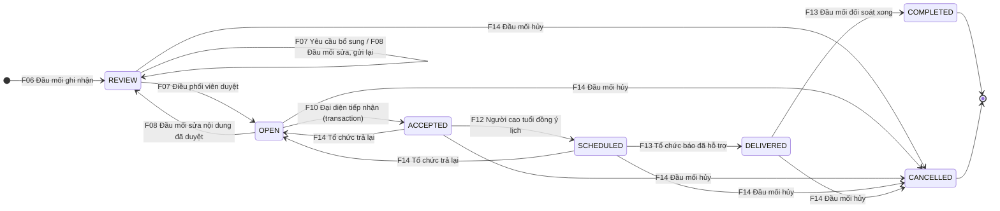
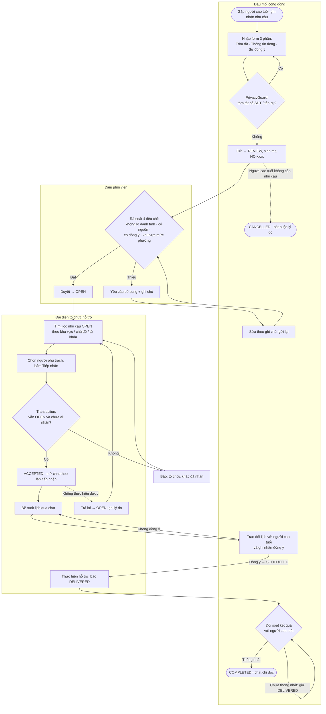

# Mục 2.1 · Sơ đồ luồng công việc (Workflow Diagram)

> **Người thực hiện:** Khiếu Hoàng Nam Anh (`31241022203`) · nhánh `feat/requests`
> **Căn cứ:** `Phạm vi chức năng.md` (F06–F15, R01–R09), code trong `data/NeedRepository.java` và `firebase/firestore.rules`.
> Mọi bước chuyển trạng thái dưới đây đều khớp với điều kiện mà app và Security Rules đang kiểm tra.

---

## 2.1.1. Các tác nhân tham gia

| Tác nhân | Quyền trong hệ thống | Vai trò trong luồng |
|---|---|---|
| **Đầu mối cộng đồng** | `RECORDER` của đơn vị ghi nhận | Ghi nhận nhu cầu, sửa khi chưa có tổ chức nhận, xác nhận lịch với người cao tuổi, đối soát kết quả, hủy nhu cầu. |
| **Điều phối viên** | `REVIEWER` của **cùng** đơn vị ghi nhận | Rà soát nội bộ 4 tiêu chí, duyệt sang `OPEN` hoặc yêu cầu bổ sung. Không được tự duyệt nhu cầu do chính mình ghi nhận. |
| **Đại diện tổ chức hỗ trợ** | `REPRESENTATIVE` của tổ chức tiếp nhận | Tìm và tiếp nhận nhu cầu, giao người phụ trách, đề xuất lịch, báo đã hỗ trợ, trả lại khi không thực hiện được. |
| **Người cao tuổi** | Không cần tài khoản | Đồng ý hoặc từ chối phương án, lịch hẹn và xác nhận kết quả thông qua đầu mối. |
| **Hệ thống (Firebase)** | Firestore Transaction + Security Rules | Kiểm tra quyền và trạng thái hiện tại trên máy chủ ở mọi bước (R06), chặn nhận trùng (R04). |

Quyền được cấp sẵn tại `memberships/{uid}/organizations/{orgId}`; người dùng không tự chọn vai trò trên giao diện (R01).

---

## 2.1.2. Sơ đồ trạng thái của một nhu cầu hỗ trợ

**Hình 2.1.** Vòng đời trạng thái của nhu cầu hỗ trợ.

| Trạng thái | Ý nghĩa | Ai nhìn thấy bản tóm tắt |
|---|---|---|
| `REVIEW` | Chờ rà soát hoặc chờ bổ sung (`needsRevision = true`) | Đơn vị ghi nhận |
| `OPEN` | Đã duyệt, chờ tổ chức tiếp nhận | Mọi tài khoản đã đăng nhập (chỉ phần tóm tắt) |
| `ACCEPTED` | Đã có một tổ chức và một người phụ trách | Đơn vị ghi nhận + tổ chức phụ trách |
| `SCHEDULED` | Đã thống nhất lịch, người cao tuổi đồng ý | Như trên; người phụ trách được đọc thông tin riêng |
| `DELIVERED` | Tổ chức báo đã hỗ trợ, chờ đối soát | Như trên |
| `COMPLETED` | Đầu mối xác nhận hoàn thành nhu cầu cụ thể (R09) | Như trên, chat chỉ đọc |
| `CANCELLED` | Đầu mối hủy kèm lý do | Như trên, chat chỉ đọc |

---

## 2.1.3. Sơ đồ luồng công việc theo tác nhân

**Hình 2.2.** Luồng công việc phối hợp giữa các tác nhân (swimlane).

---

## 2.1.4. Bảng điều kiện chuyển trạng thái

Mỗi bước được thực hiện trong một `db.runTransaction()`: đọc trạng thái hiện tại trên máy chủ → kiểm tra quyền và điều kiện → ghi. Đồng thời Security Rules kiểm tra lại cùng điều kiện, nên người dùng không thể sửa trạng thái trực tiếp (R06). Mỗi bước đều ghi thêm một sự kiện vào `needs_summary/{id}/events` để làm lịch sử.

| # | Từ → Đến | Mã | Người thực hiện | Điều kiện kiểm tra | Dữ liệu ghi |
|:-:|---|:-:|---|---|---|
| 1 | ∅ → `REVIEW` | F06 | `RECORDER` | Tóm tắt không chứa SĐT/tên cụ; có thông tin đồng ý | `needs_summary`, `needs_private`, tăng `counters/needs.next` |
| 2 | `REVIEW` → `REVIEW` | F07 | `REVIEWER` cùng đơn vị, khác người ghi nhận | Bắt buộc ghi chú | `needsRevision = true`, `reviewNote` |
| 3 | `REVIEW` → `OPEN` | F07 | `REVIEWER` cùng đơn vị, khác người ghi nhận | Đủ 4 tiêu chí: tóm tắt không lộ danh tính, có nguồn ghi nhận, đã ghi nhận đồng ý, khu vực chỉ ở mức phường | `needsRevision = false`, `reviewerUid`, `reviewedAt` |
| 4 | `REVIEW`/`OPEN` → `REVIEW` | F08 | `RECORDER` của đơn vị ghi nhận | Chưa có tổ chức nhận | Nội dung mới; nhu cầu rời khỏi danh sách "Tìm để tiếp nhận" |
| 5 | `OPEN` → `ACCEPTED` | F10 | `REPRESENTATIVE` | Vẫn `OPEN` **và** `currentAssignmentId == null` | Tạo `needs_assignments/{id}` (`ACTIVE`), gán `assignedOrgId`, `assigneeUid`, `currentAssignmentId` |
| 6 | `ACCEPTED`/`SCHEDULED` → `OPEN` | F14 | `REPRESENTATIVE` của tổ chức đang phụ trách | Chưa báo đã hỗ trợ (R07); bắt buộc lý do | Xóa gán tổ chức, `returnCount + 1`; lần tiếp nhận cũ → `RETURNED` |
| 7 | `ACCEPTED` → `SCHEDULED` | F12 | `RECORDER` | Người cao tuổi đã đồng ý lịch | Lịch hẹn (nhánh `feat/chat-schedule`) |
| 8 | `SCHEDULED` → `DELIVERED` | F13 | Thành viên tổ chức phụ trách | — | Báo cáo kết quả |
| 9 | `DELIVERED` → `COMPLETED` | F13 | `RECORDER` | Đối soát thống nhất với người cao tuổi | Chat chuyển chỉ đọc |
| 10 | Mọi trạng thái chưa kết thúc → `CANCELLED` | F14 | `RECORDER` của đơn vị ghi nhận | Chưa `COMPLETED`/`CANCELLED`; bắt buộc lý do ("Lý do khác" phải có ghi chú) | `cancelReason`, `cancelNote`; lần tiếp nhận đang chạy → `CLOSED` |

**Quy tắc xem thông tin riêng (R03):** `needs_private` chỉ đọc được bởi thành viên đơn vị ghi nhận, hoặc đúng người phụ trách khi nhu cầu đang `SCHEDULED`/`DELIVERED`. Tiếp nhận (`ACCEPTED`) chưa đủ để xem họ tên, địa chỉ, số điện thoại của người cao tuổi.

---

## 2.1.5. Điểm kiểm soát chính trong luồng

1. **Chống nhận trùng (R04):** Hai tổ chức bấm "Tiếp nhận" cùng lúc thì transaction của người đến sau đọc thấy `currentAssignmentId` đã có giá trị và bị từ chối với thông báo *"Nhu cầu này vừa được tổ chức khác tiếp nhận"*.
2. **Không báo thành công giả khi offline:** Transaction của Firestore cần kết nối máy chủ. App kiểm tra mạng trước khi gửi và báo người dùng cần kết nối.
3. **Rà soát độc lập (R05):** Điều phối viên không được duyệt nhu cầu do chính mình ghi nhận.
4. **Mỗi lần tiếp nhận là một bản ghi riêng (R07, R08):** `needs_assignments` không bị xóa khi trả lại. Chat gắn theo `currentAssignmentId`, nên người phụ trách cũ không xem được trao đổi mới.
5. **Không tự đóng nhu cầu chưa giải quyết:** Tổ chức chỉ được trả lại về `OPEN`, không được hủy. Chỉ đầu mối được hủy, và phải ghi lý do.
